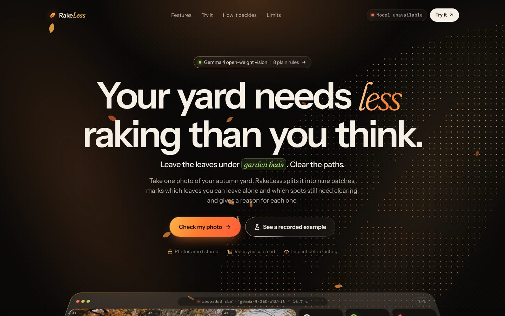
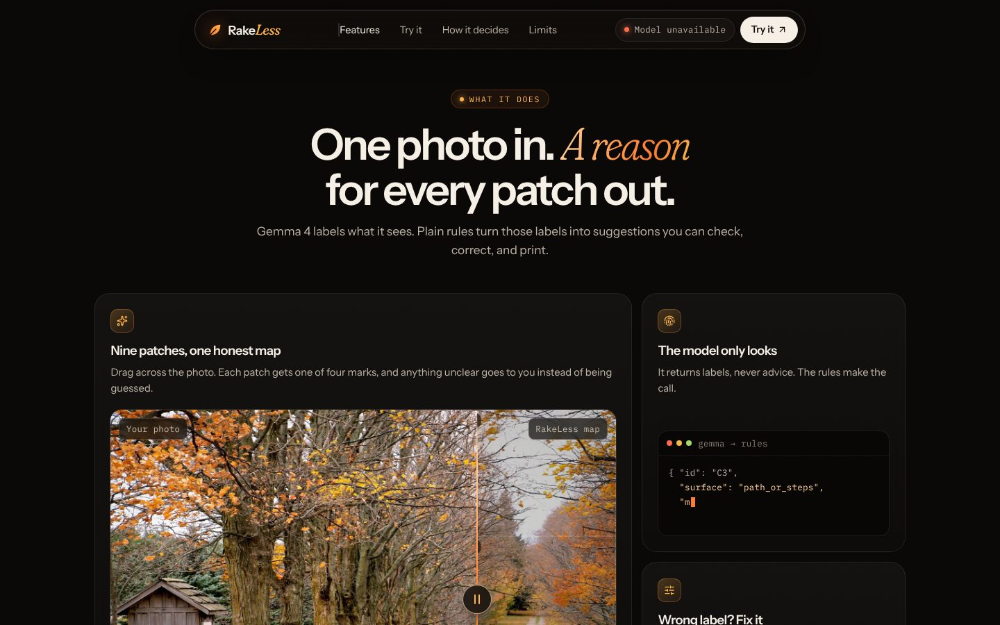
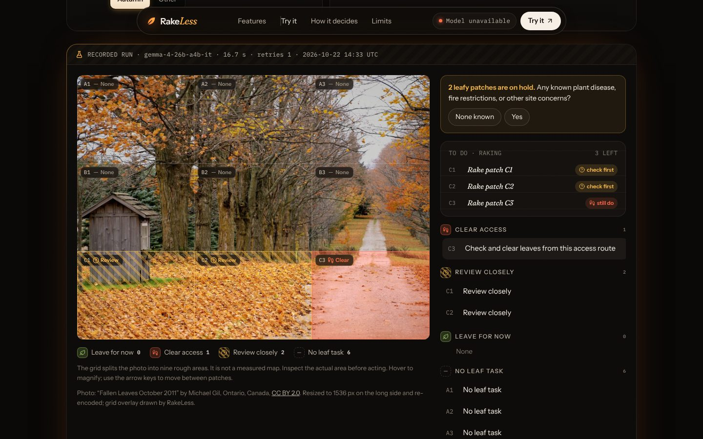
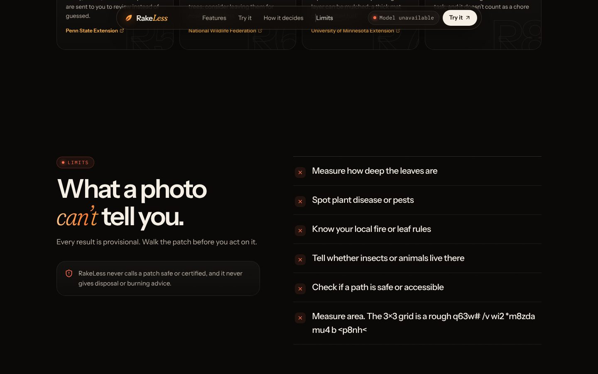

# RakeLess 🍂

**Mark the yard patches you were going to rake. RakeLess shows which of that work is worth reconsidering, which access work to keep, and which patches you need to look at first.**

Fallen leaves in garden beds and under trees give shelter to insects and the birds that eat them. Leaves on a path still need clearing. RakeLess splits one ground-level photo into nine patches, has an open-weight Gemma model describe each patch with a few fixed labels, and runs nine plain rules over those labels. You can correct any label; the plan and the chore receipt update without another model call.

> Every result is a suggestion from a photo. It cannot see leaf depth, plant disease, or local rules. Walk the patch before you act.

- **Live demo:** https://rakeless.vercel.app (hosted Gemma through the Gemini API, see [Privacy](#privacy-and-retention))
- **Local mode:** the same app with Gemma 4 in Ollama on your machine; an HTTP run with external network blocked is verified (see [Local inference](#local-inference-with-ollama))
- **Evaluation:** 7 licensed scenes, proxy labels written before the model ran; the local model is safe but mostly abstains (see [Evaluation](#evaluation))



---

## A tour of the site

| | |
|---|---|
| **Hero.** A dot-matrix leaf that reacts to your cursor, falling leaves, and a real recorded run shown as a 3D app window. Tap any patch to see what Gemma saw. | **Features.** A before/after slider over the real photo, a live model-to-rule demo, a looping correction demo, the cited sources, and the printable yard sign. |
|  |  |
| **Workbench.** Set your site context, drop a photo, and get a nine-patch map. Click a patch to inspect it, correct the model, and see the source behind each call. | **How it decides.** The six-step pipeline lights up as you scroll, followed by one card per rule showing the result it produces. |
|  |  |

---

## How it works

```
photo ─► server: decode, rotate, strip metadata, 3×3 grid ─► Gemma (hosted or local) labels 9 patches
      ─► schema check (server + browser) ─► 9 ordered rules ─► map + chore receipt ─► you correct ─► rules re-run
```

1. **The model only looks.** For each patch it returns `surface` (bed/tree base, lawn, path/steps, mixed, unknown), `material` (fallen leaves, none, unclear), `visibility` (clear, unclear) and one sentence of visible evidence. It gives no advice.
2. **Rules decide** (`shared/rules.ts`, the same code on server and browser). Order matters and is tested:

   | Rule | When | Result |
   |---|---|---|
   | R2 | outside temperate North American autumn | review (no leave/clear advice) |
   | R8 | clearly no fallen leaves on the ground | no leaf task (never counted as saved work) |
   | R5 | unclear view, unclear material, mixed or unknown surface | **review**, including a possible path |
   | R3 | a clearly seen path or steps with leaves | clear access |
   | R4 | site concerns reported, unresolved, or flagged on the patch | review |
   | R6 | bed or tree base with leaves | leave for now (suggestion; walk it first) |
   | R7 | lawn with leaves | review (a photo cannot show depth) |
   | R9 | anything else | review |

   The hosted request sends Gemini's `responseSchema`; Google's Gemma page does not document structured output for Gemma, so the app never relies on it: every answer from either provider is validated with Zod on the server and again in the browser, and an invalid one gets at most one retry.

   Uncertainty is checked before the path rule, so an unclear "path" goes to inspection instead of becoming a chore. `tests/rules.test.ts` enumerates all 1,080 combinations of context, surface, material, visibility and patch concern and checks that "leave", "clear" and "none" are only produced where the rules allow.
3. **You correct.** Change the surface or material, mark a site concern, or confirm you looked at an unclear patch in person. The model's original labels are kept next to yours, in the inspector, the receipt and the export.
4. **Chore receipt.** Optionally mark the patches you planned to clear. Nothing is preselected. The receipt splits your plan into *worth reconsidering*, *inspect first*, and *no leaf task observed*, and always lists *access work to keep*. Counts are grid cells: no area, minutes, money or ecological benefit are inferred.

---

## Run it locally

You need **Node 20.19+** (or 22.12+). Pick a provider.

### Hosted Gemma (Gemini API)

```bash
npm install
cp .env.example .env               # set GEMINI_API_KEY
set -a; . ./.env; set +a
npm run dev                        # UI → http://127.0.0.1:5173 (API on 127.0.0.1:8787)
```

Photos go from your machine to Google. Running the frontend locally does not make this offline.

### Local inference with Ollama

```bash
ollama pull gemma4:e4b             # vision-capable Gemma 4, 6.6 GB download (Q4_K_M)
ollama serve                       # if it is not already running
npm install && npm run build
npm run start:local                # RAKELESS_PROVIDER=ollama; app + API on http://127.0.0.1:8787
```

`OLLAMA_URL` (default `http://127.0.0.1:11434`) and `OLLAMA_MODEL` (default `gemma4:e4b`) are server settings; the browser cannot choose an endpoint. Readiness (`/api/health`) checks that the model is pulled and reports `vision` capability, and records the local manifest digest as the model version. If Ollama is down or the model is missing, the header says so with the exact `ollama pull` command; nothing falls back to the cloud.

**What was verified here** (2026-10-22, 4-core x86 CPU container, 15 GB RAM, no GPU, Ollama 0.40.8):
- `gemma4:e4b` (Q4_K_M, 7.5B parameters, digest `dc35e8d9…`) answered all 7 evaluation scenes with a valid nine-cell structure, taking 95–226 s per photo on CPU. Its labels were weak: see [Evaluation](#evaluation).
- Inside a Linux network namespace with only loopback (external addresses and DNS unreachable), `POST /api/analyze` through the full RakeLess server returned a live, uncached local result in 112.6 s (and 111.7 s in a second run). Evidence and the failed attempts: [`eval/results/OFFLINE.md`](eval/results/OFFLINE.md); `scripts/offline-run.sh` reproduces it.
- A captioned **browser** demo of the local run could not be recorded here: with Chromium capturing video on the same 4 cores, inference slowed about 10× and all four attempts timed out. Those runs are kept as evidence.
- `gemma4:e2b` also ran (147 s) but labelled every cell of the development photo "mixed / unclear", so `e4b` is the default.

The public Vercel deployment cannot reach `localhost` on a visitor's computer. Local mode means running this server yourself, next to Ollama. A GPU will be much faster than the CPU numbers above; local inference still costs download time, disk, and electricity.

| Command | What it does |
|---|---|
| `npm run dev` | Vite dev server + local API (loopback) |
| `npm run build` / `npm start` | Production build; serve `dist/` and the API on port 8787 |
| `npm run start:local` | Same, with `RAKELESS_PROVIDER=ollama` |
| `npm test` | Vitest: rules, receipt, contract, image handling, deadline/retry, cache, readiness, providers (HTTP mocked) |
| `npm run typecheck` | TypeScript |
| `npm run eval` | Run the evaluation set against the configured provider (fresh calls, no cache) |
| `node scripts/check-ui.cjs` | Playwright journey check at desktop and mobile sizes (`BASE=…`, optional `--upload photo.jpg`) |
| `npm run record-example -- <photo>` | Re-record the bundled example from a real run |
| `sh scripts/offline-run.sh` | Ollama + server in a loopback-only network namespace; one `/api/analyze` call; evidence to `eval/results/offline-run/`. `DEMO=1` also records the captioned browser demo (needs more CPU than 4 cores) |
| `sh scripts/cut-demo.sh` | Cut the model wait out of the recorded demo and encode MP4 |

---

## Deploy to Vercel

1. Import the repo. `vercel.json` sets the Vite build, the `api/` functions (`analyze` up to 60 s), and security headers.
2. Add **`GEMINI_API_KEY`** (Sensitive) for Production and Preview. Leave `RAKELESS_PROVIDER` unset (hosted).
3. Add a **Vercel Firewall rate-limit rule** on `/api/analyze` and a **budget alert** in Google AI Studio. The in-app limits are per instance (below).

---

## Privacy and retention

| What | Where it goes | How long |
|---|---|---|
| Your photo (hosted mode) | Your browser → this server → Google's Gemini API | Not stored by RakeLess. Google's [Gemini API terms](https://ai.google.dev/gemini-api/terms) apply: on **unpaid** keys, Google may use inputs to improve its products and human reviewers may read them; on paid keys Google logs prompts for a limited period for abuse detection. Which tier the public demo uses depends on the deployer's account. |
| Your photo (local mode) | Your browser → this server → Ollama on the same machine | Not stored by RakeLess. RakeLess does not control Ollama's own logging; check your setup. |
| Normalized image | Returned to your browser as a data URL so the map can be drawn | Only in your tab. Not cached on the server. |
| The nine labels + evidence text | In-memory observation cache on the server process that served you | Up to 10 minutes (`OBSERVATION_CACHE_TTL_MS`, 0 disables), max 32 entries, keyed by image hash + provider + model + prompt + input settings. Evidence text can describe what is in your photo. |
| Corrections, plan, receipt | Your browser only | Until you close or reset. Export is a local file. |
| Logs | Server logs | Failure events only: provider, status, attempt count, duration. No images, prompts, evidence, or provider payloads. |

**Start over** clears the page. It cannot erase anything at Google, in another serverless instance's memory cache, or in a file you exported. EXIF metadata (including GPS) is removed before the model sees the photo. Do not upload photos of people, house numbers, or anything private.

---

## Abuse protection (and its limits)

| Layer | What it does | Limit |
|---|---|---|
| Key on the server | `GEMINI_API_KEY` is only read server-side; the client never picks a model or endpoint | — |
| Same-origin check | Refuses posts whose `Origin`/`Sec-Fetch-Site` is another site, so other pages can't spend the key through their visitors' browsers | **Not authentication.** A script can send any headers |
| Validate before spending | One image field, size, decoded format, pixel count and context are checked before any model call | The local server also caps the request body at 9 MB while streaming |
| Per-visitor limit | 6 photos / 10 minutes per client address (429) | Address comes from Vercel's own headers, or the socket locally; spoofable `X-Forwarded-For` is ignored unless `TRUST_PROXY=1` |
| Daily budget | 400 **upstream calls** per UTC day, retries counted; a retry is not started once the budget is spent | Per process |
| Concurrency | 1 analysis at a time per process (409) | Per process |
| Request deadline | One budget per request (52 s hosted) covering image work, attempts, and the response, with a 2.5 s reserve. At most 2 attempts; a retry only for invalid JSON/schema or a transient 5xx/network error, and only if ≥10 s remain. Quota, auth, 400 and timeouts are never retried. Browser disconnects abort the upstream call | — |
| Cache | Repeat photos within 10 minutes are answered from the observation cache, labelled `CACHED` | Per process |

All in-memory counters are **per serverless instance**, not global. The Vercel Firewall rule and a provider budget alert are the shared outer layer.

---

## Evaluation

Full method and per-cell results: [`eval/README.md`](eval/README.md). Short version:

- **7 distinct, licensed photos** (Wikimedia Commons, authors and licenses in `eval/manifest.json`), covering lawn, sidewalk, driveway, steps, beds/woodland floor, mixed cells, out-of-focus and dark photos, and out-of-scope places and seasons. Target was 8–12; Commons rate-limited further downloads.
- **Reference labels were written by the AI coding agent before any model ran on these photos** and committed first. This is an agent-labeled proxy evaluation, not expert ground truth.
- **Local `gemma4:e4b` on a 4-core CPU:** 7/7 valid structures, 0 retries, 95–226 s per photo (median 124 s). It sent **61 of 63 cells to review**, reached the reference action on **1 of 7** actionable cells (1 of 26 in the in-scope counterfactual), and made **0 critical confusions** (never *leave* or *no task* where the reference disagreed).
- Biggest failures: tree-canopy cells reported as "lawn with fallen leaves"; a sharp driveway reported as "unclear" in every cell; repeated boilerplate evidence. The rules turned all of these into review, and each can be corrected in the inspector.
- **Hosted Gemma was not evaluated** (no API key in this session). Earlier hosted timings (16.7 s for the recorded example, ~58 s wall time for one later live request) come from a single scene and its transforms, so they are anecdotes, not a speed claim.

In short: the observation/rule split keeps a weak model from giving confident wrong advice, but with the small local model most of the work still lands on you as "review".

---

## API

| Endpoint | Returns |
|---|---|
| `GET /api/health` | App readiness and **selected-provider** readiness: `status` (`ready` / `unavailable` / `config_error`), provider, local flag, destination text, model, version/digest, reason, retention settings, request budget |
| `POST /api/analyze` | Multipart: one `image` (JPEG/PNG/WebP ≤ 8 MB, ≤ 20 MP) + `context` (JSON). Returns the normalized image, nine observations and provenance (provider, model, version/digest, prompt and rules versions, image hash, model time, server request time, attempts, cache status) |
| `GET /api/examples/fallen-leaves` | The bundled recorded run (`mode: "recorded"`) |

Errors are JSON with an `error` message (and `attempts` for model failures): `400` bad upload, `403` cross-origin, `409` busy, `413` too large, `429` rate or budget limit, `499` cancelled, `502` invalid model output, `503` provider not configured/unavailable, `504` deadline reached. An error never returns sample results.

---

## Design

The interface is a dark "field lab at dusk": warm near-black, ember light for the brand, moss for what can stay, coral for paths to clear. Layout and type cues come from the hero and bento sections curated on [vibrant.design](https://vibrant.design/). The effects are reworked from ideas in [Aceternity UI](https://ui.aceternity.com/components) and written for this app in `src/ui/`, using plain CSS and `motion`, with no Tailwind and no copied components:

| Piece | Based on | What changed |
|---|---|---|
| `DotField` | Dotted Glow, Background Ripple | A dot matrix that draws a leaf, glows near the pointer, and ripples on click |
| `LeafFall` | Sparkles | Falling leaves with depth that drift away from the pointer |
| `GlowCard` | Glowing Effect + Card Spotlight | One shell: a border light that follows the pointer's angle, plus an inner spotlight |
| `GlowButton` | Moving Border, Hover Border Gradient, Magnetic Button | An orbiting border, a glow that follows the pointer, a magnetic pull |
| `Compare`, `CipherCard`, `CardStack` | Compare, Evervault Card, Card Stack | A keyboard-accessible slider, cipher text revealed under the pointer, a deck with depth blur |
| `ScrollStage`, `TracingBeam`, `InfiniteCards` | Container Scroll, Tracing Beam, Infinite Moving Cards | Spring-smoothed and paused when hovered or focused |
| `FlipWords`, `Scramble`, `Typewriter`, `Wordmark` | Flip Words, Encrypted Text, Typewriter, Text Hover Effect | Adapted for screen readers and reduced motion |
| `Segmented` | Tabs | A radio group with a sliding pill and arrow-key navigation |

All motion respects `prefers-reduced-motion`. Canvas loops pause when off screen, and the print view (plan plus yard sign) is unchanged.

## Tech stack

React 19, Vite, TypeScript, `motion` for animation, `lucide-react` icons, Zod for the model contract, and `sharp` on the server. Fonts: Instrument Sans, Fraunces (italic accents) and IBM Plex Mono. The styling is plain CSS in `src/styles.css`, with no Tailwind.

## Project layout

```
api/            Vercel functions (thin wrappers)
server/         image normalization, providers (gemini, ollama), deadline/retry loop, cache, guards, handlers, local server
shared/         schema (Zod), grid geometry, rules, receipt, sources (used by server AND browser)
src/            React app (photo map, inspector, corrections, chore receipt, print view)
eval/           evaluation manifest, licensed images, results, method notes
scripts/        eval, UI check, demo recording, example recording
data/           recorded real example run
tests/          Vitest
```

## Similar tools

Photo-based garden apps exist, for example [YardSense](https://apps.apple.com/app/id6742723177) (lawn health from a photo), [Plant Help](https://apps.apple.com/app/id6759781756) ("what to do now" plant guidance) and FloraAI (garden design from the camera). RakeLess overlaps with them on "photo in, advice out". What it does differently is narrower: a fixed nine-patch observation contract, published rules that make every decision (the model never advises), uncertainty routed to inspection, corrections that re-run the rules without another model call, a receipt measured against the user's own plan, and a swappable open-weight model that can run on your machine. We have not tested those apps.

## What it can't do

It cannot measure leaf depth, spot disease or pests, know your local fire or leaf rules, tell whether animals live there, judge path safety, or measure area. The 3×3 grid is a rough split of the photo; a cell can mix surfaces, and then it gets "review". The rules were written for **temperate North American autumn yards**; elsewhere every leafy patch becomes review-only.

## License

MIT for the code. Photos: see [ATTRIBUTION.md](ATTRIBUTION.md) and `eval/manifest.json` (CC BY / CC BY-SA, by their authors).
